# Mermaid style and contrast review

Import this into an empty Markdown document. Review each diagram in Light and Dark mode, inline and in Full preview. Labels should be readable on their actual node/region backgrounds; shapes and symbols remain specific to their diagram type.

## Flowchart: labels, groups and edges

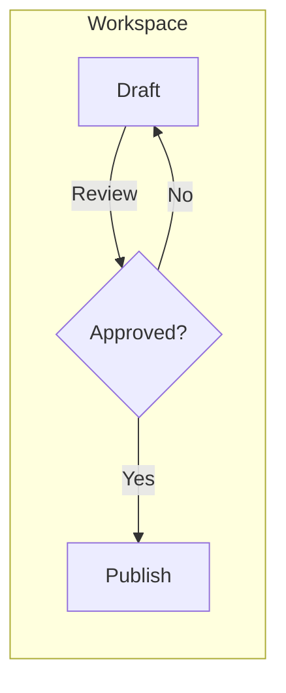

## Sequence: notes, loops and sequence numbers

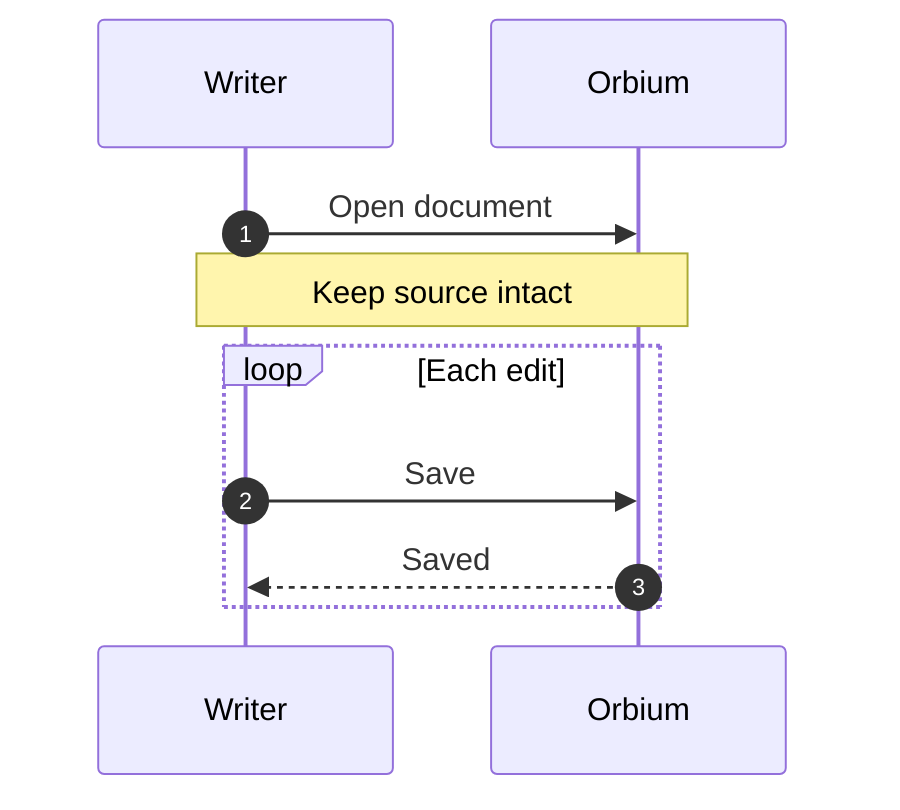

## Class: titles, members and relationships

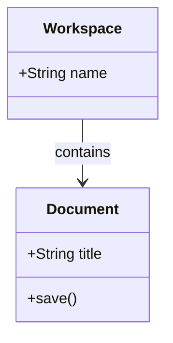

## ER: entity titles, attribute rows and labels

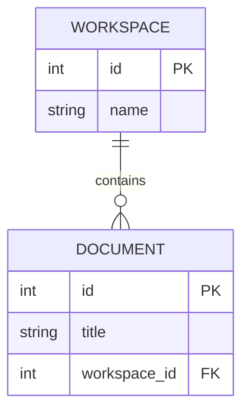

## State: composite regions and transitions

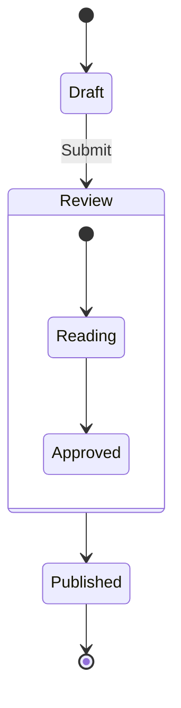

## Pie: percentages, title and legend

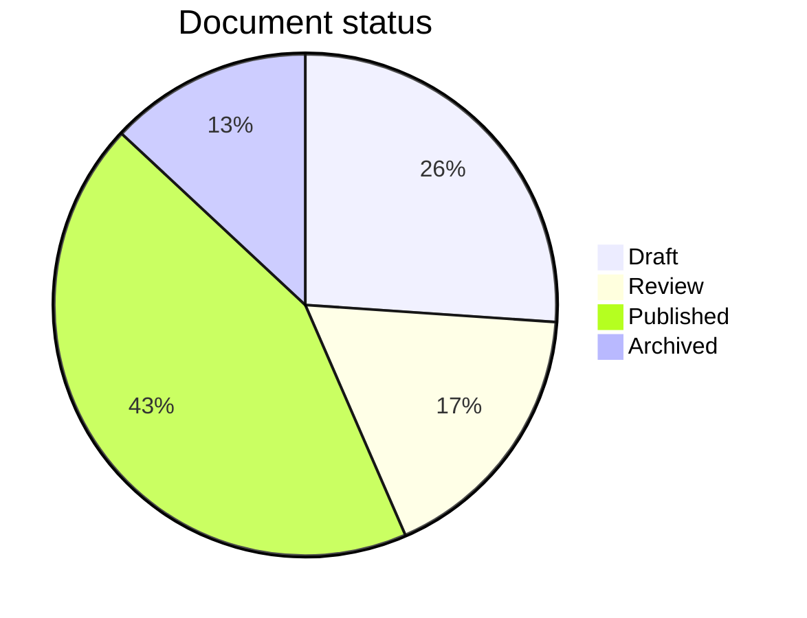

## XY chart: axis labels, title and bars

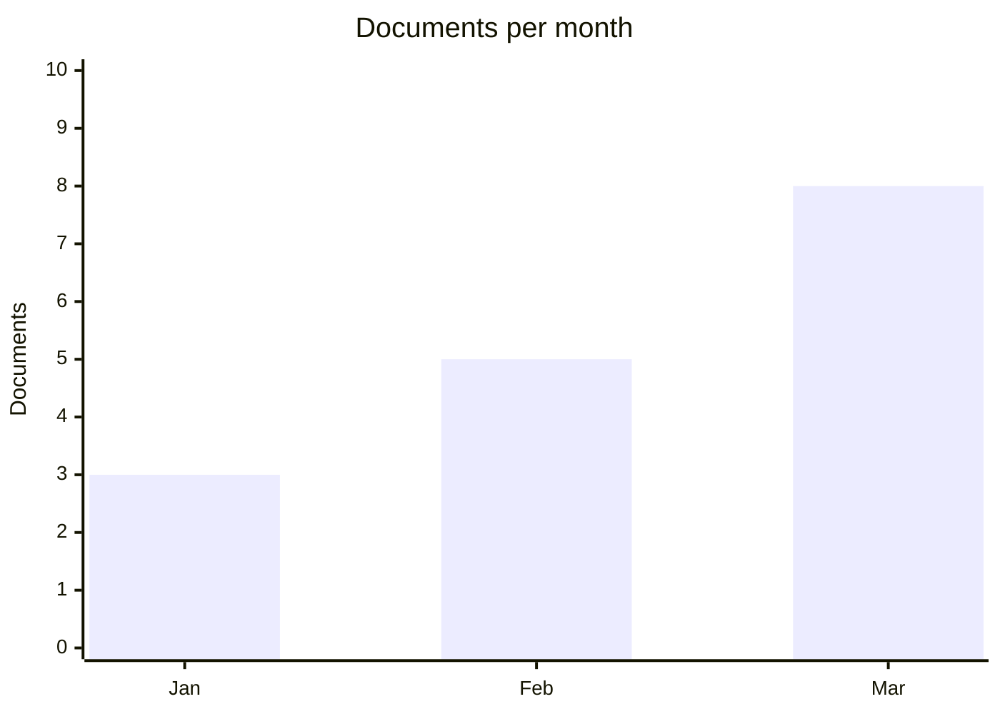

## Gantt: section shading and task labels

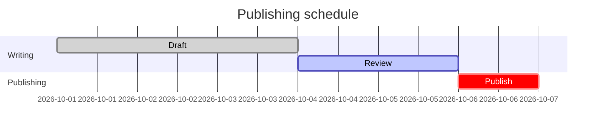

## Timeline: section and event labels

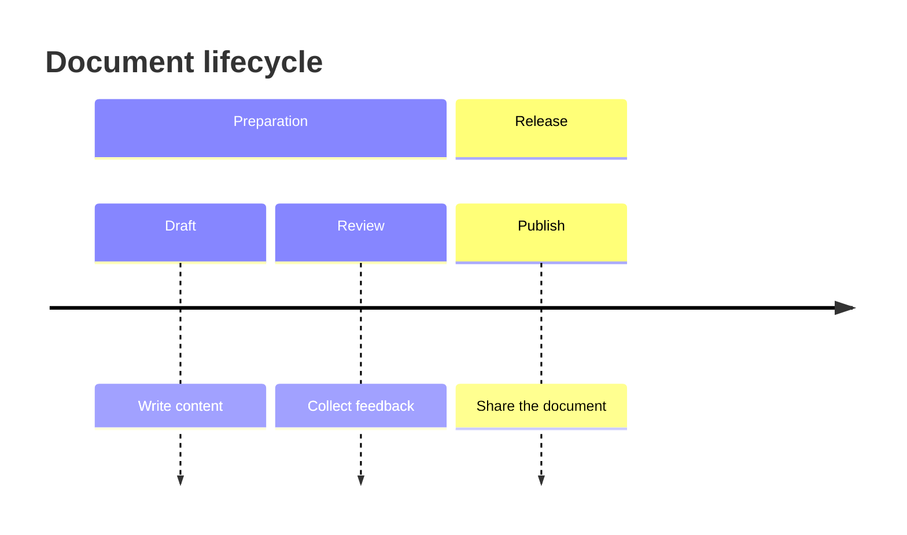

## Journey: task and actor labels

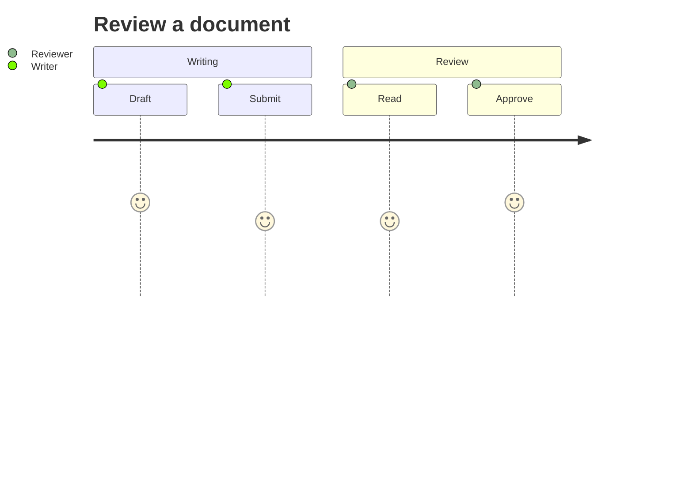

## Git graph: branch, tag and commit labels

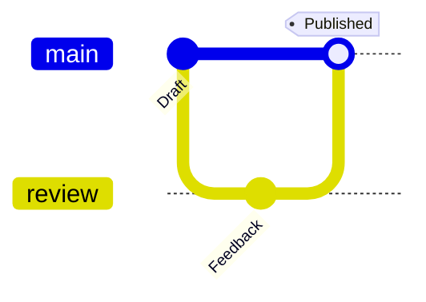

## Mindmap: root and branch labels

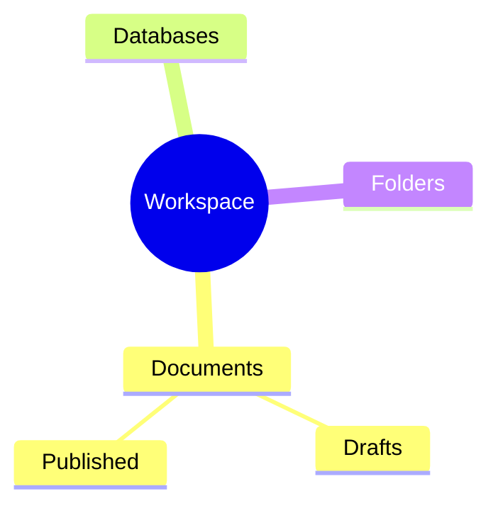

## Quadrant: regions, axis labels and points

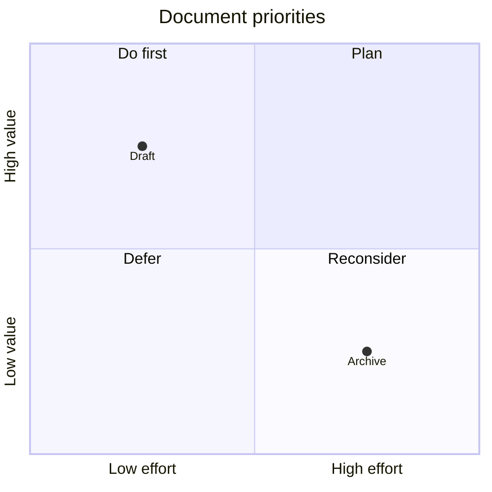

## Requirement: titles, fields and relationships

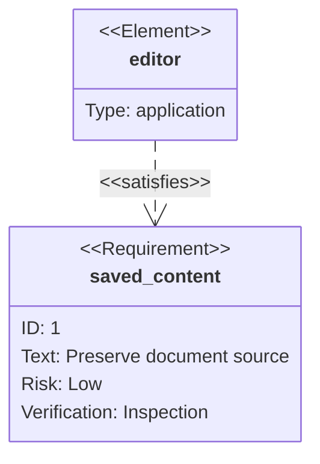

## Block: node labels and links

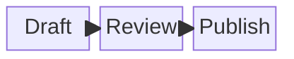

## Architecture: groups, services and edges

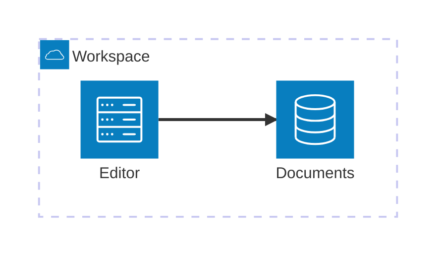

## Packet: numeric markers and field labels

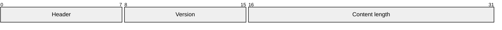

## Sankey: labels and flow bands

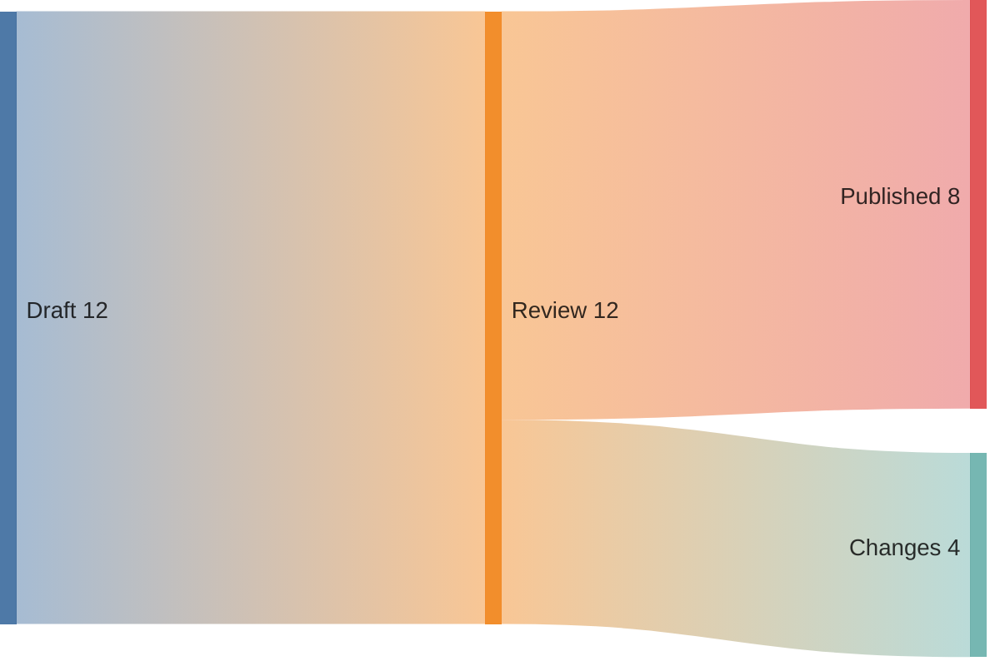

## C4: people, systems and relationship text

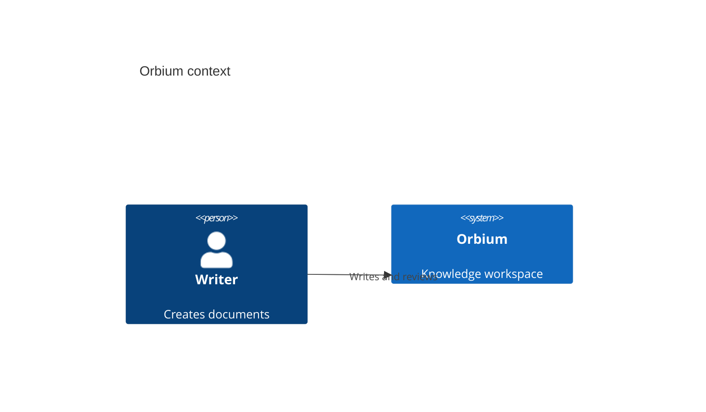
