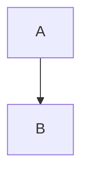

# Live Preview review

## Heading two

### Heading three

###### Preserved heading six

A **bold**, *italic*, ~~struck~~ paragraph with `inline code`.

An **outer *nested italic* span** and [a safe link](https://example.com).

- First bullet
- Second bullet
    - Nested bullet

7. Seventh item
8. Eighth item

- [ ] Pending task
- [x] Completed task
    - [ ] Nested task

> A quote with **bold text**.
>
> Another quote paragraph.

---

```text
**Literal code**
/heading does not open a menu here.
```

> [!NOTE]
> Callouts keep editable source until M4.

| Column 1 | Column 2 |
| --- | --- |
| Alpha | Beta |



Inline $x_1$ and a literal math source $a * b * c$.

$$
E = mc^2
$$

:::orbium {"kind":"block","dir":"rtl","align":"center"}
مرحبا Orbium 123
:::

:orbium[Colored]{"color":"preset:red","underline":true}

Escaped \*asterisks\* remain literal.

<script>window.orbiumM3Executed = true</script>
