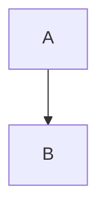
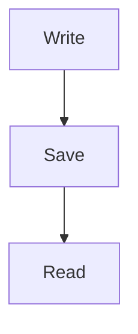

# Rich block review

A paragraph with **bold**, *italic*, ~~strike~~, `inline code`, and inline $E = mc^2$.

:orbium[**Theme-aware purple and underline**]{"color":"preset:purple","underline":true}

## Code

```typescript
const greet = (name: string) => `Hello, ${name}`;
console.log(greet('Orbium'));
```

```unknown-language preserve-this-info
Unknown languages stay plain and editable.
```

:::orbium {"kind":"code"}

:::

## Mermaid



## Equations

$$
\frac{a}{b} = \sqrt{x}
$$

:::orbium {"kind":"math","latex":"\\text{An escaped block with }\\alpha"}
:::

Inline escape: :orbium-math{"latex":"x^2 + y^2"}.

## Callouts

> [!NOTE]
> A **formatted** callout.
>
> - First item
> - Second item

> [!TIP]- Collapsed title
> Open this callout to read its body.

## Tables

| Name | Meaning |
| :--- | ---: |
| Alpha | First |
|  |  |

:::::orbium {"kind":"table"}
::::orbium {"kind":"row"}
:::orbium {"kind":"cell","header":true,"colwidth":[180]}
Left
:::
:::orbium {"kind":"cell","header":true,"colwidth":[180]}
Right
:::
::::
::::orbium {"kind":"row"}
:::orbium {"kind":"cell","colspan":2,"colwidth":[180,180]}
First paragraph.

Second **paragraph** with $x^2$.
:::
::::
:::::

:::::orbium {"kind":"table"}
::::orbium {"kind":"row"}
:::orbium {"kind":"cell","rowspan":2}
Two rows
:::
:::orbium {"kind":"cell"}
Top right
:::
::::
::::orbium {"kind":"row"}
:::orbium {"kind":"cell"}
Bottom right
:::
::::
:::::

## Presentation metadata

:::orbium {"kind":"block","dir":"rtl","align":"right"}
فقرة عربية باتجاه صريح.
:::

:::orbium {"kind":"block","listType":"A"}
3. Third entry
4. Fourth entry
:::

:::orbium {"kind":"empty","dir":"rtl","align":"center"}
:::

## Literal HTML

<script>alert('This must remain text')</script>

```text
[Unsafe link must stay text](javascript:alert)

```
