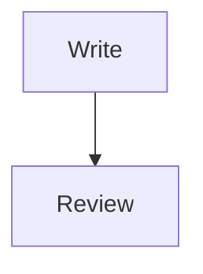

# Editor UI review

Compare this writing surface with an equivalent legacy document.

Select **bold words**, *italic words*, ~~struck words~~ and `inline code`.

:orbium[Colored and underlined text]{"color":"preset:purple","underline":true}

Literal brackets: \[draft\]. An ampersand: &amp;.

## Lists and quotes

- First bullet
- Second bullet
  - Nested bullet

3. Third item
1. Fourth item despite the source marker
1. Fifth item

- [ ] A task to complete
- [x] A completed task

> A quote with **formatted text**.
> A second source line.

> [!NOTE]
> Click here and edit the callout text directly.

## Direction and alignment

:::orbium {"kind":"block","dir":"rtl","align":"right"}
اكتب هنا ثم اضغط Enter لإنشاء فقرة أخرى.
:::

:::orbium {"kind":"block","align":"center"}
Centered text remains editable without an Edit block card.
:::

:::orbium {"kind":"block","listType":"a"}
1. Alphabetic first item
2. Alphabetic second item
:::

:::orbium {"kind":"empty","dir":"rtl","align":"right"}
:::

## Rich blocks

```typescript
const label = 'Edit this code directly';
console.log(label);
```



Inline $E = mc^2$ opens an in-place source field.

$$
\frac{x}{y}
$$

| Name | Details |
| --- | --- |
| Alpha | **Formatted** cell |
| Beta | Another cell |

---

Add a real image, file and mention using /image, /file and @. This fixture contains no installation-specific attachment or node IDs.
