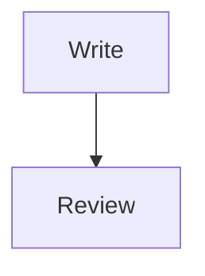

# Interaction review

Select words in this paragraph and try bold, italic, underline, strike, inline code, links and text colors.

alpha **beta** gamma

A literal bracket: \[draft\]. An entity: &amp;.

:orbium[Theme-aware text]{"color":"preset:purple","underline":true}

## Block controls

First movable paragraph.

Second movable paragraph.

- A bullet with **formatting**
- Another bullet
  - Nested bullet

1. First numbered item
2. Second numbered item

- [ ] An incomplete task
- [x] A completed task

> A quote with two source lines.
> Select or move the complete quote.

> [!NOTE]
> A callout with **nested formatting**.

## Direction

مرحبا بكم في مساحة الكتابة

12345

English text mixed with العربية and עברית.

:::orbium {"kind":"block","dir":"rtl","align":"right"}
فقرة باتجاه صريح ومحاذاة إلى اليمين.
:::

## Source-backed rich blocks

```typescript
const label = 'searchable-code';
```



Inline $E = mc^2$ and a display equation:

$$
\frac{x}{y}
$$

| Name | Details |
| --- | --- |
| Alpha | **Formatted** cell |
| Beta | Another cell |

###### Imported H6 remains H6 in Source

Add real mentions with @ and attachments with /image or /file. This fixture intentionally has no installation-specific IDs.
