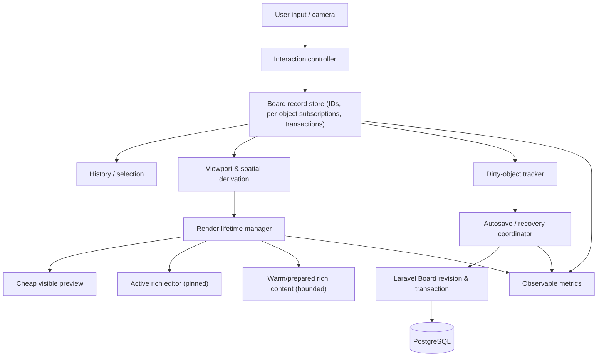

# Orbium Performance Engine — architecture and execution contract

Status: **Core Board architecture implemented after explicit user direction; manual acceptance and measured performance remain pending. Existing phase-4 review continues.**
Prepared: 2026-10-20  
Source: `insadamt/Orbium`, branch `codex/boards`  
Scope: Boards first, reusable primitives for large Documents where evidence supports reuse.

Implementation handoff (2026-10-21): the user's “look just enhance everything
implement the new architecture” supersedes the earlier P0-only/measurement-first
execution gate. Read the [architecture/protocol contract](board-performance-architecture.md)
and [implementation report](../reports/12-boards-performance-architecture.md).
P1 record isolation, P2 rich lifecycle/scheduling, the memoized/no-render-write part
of P3, and P4 revisioned mutations are implemented. Conditional indexing, workers,
media quality experiments, asynchronous recovery journals and broad P5 Document
adaptation remain evidence-dependent. The [P0 protocol](board-performance-profiling.md)
is available for measurement; no CPU/FPS or thermal resolution is claimed.

## Decision

Build **Orbium-native**, measurable rendering and state infrastructure. Borrow ideas from tldraw (per-record reactivity, batched changes, incremental culling, cached geometry, rendering level of detail), but **do not install or embed tldraw, rewrite the entire canvas, replace editors, or introduce GPU/WebGL rendering** in this pass.

The experience should be that content *appears ready when needed*. Do not interpret "instant" as creating a DOM editor, PDF viewer and Mermaid session for every stored object at once. Preserve clear/readable rendering at normal zoom and rich editing behavior.

## Evidence and current constraints

### Baseline Board code (inspected on 2026-10-20; superseded by the implementation above)

- `resources/js/components/boards/board-canvas.tsx`: BoardWorkspace owns the shared model; it computes rendered objects and maps them into BoardObjectCard children.
- `use-board-objects.ts`: entire `BoardObject[]` is held in React state, immutable snapshots in undo/redo stacks, and `commit()` validates the collection; `apply()` publishes the collection and queues autosave.
- `use-board-block-editing.ts`: editing one block maps the complete object collection and calls `commit()`. This is an O(N) path per accepted edit even when the other N-1 objects are unchanged.
- `board-native-editor.tsx`: active Tiptap updates convert their document and compare serialized data; avoid redesigning editor semantics without profiling. `board-text-block.tsx` already mounts that native editor **only while editing**.
- `board-table-block.tsx`: mounted Board tables each initialize a hidden CodeMirror source view, `MermaidPreviewSession`, and the shared table renderer even while not editing. This is a high-value *hypothesis* for cold mount cost.
- `board-document-preview.tsx`: on mount, linked Document previews can reconstruct an entire rich DOM from saved source. The source cache saves fetches, not rich DOM construction.
- `use-board-rendered-objects.ts`: viewport filter plus weighted recent-surface retention; currently reconstructs visible sets/maps and calls `setRecentIds` during render if retention changes. Avoid state updates during render.
- `use-board-visible-bounds.ts`: 640px overscan with 160px guard already limits camera-triggered React updates; `use-board-camera.ts` already translates the world during pans and uses layout zoom for clarity. **Do not blindly reintroduce transform-only zoom.**
- `use-board-pointer.ts`, `board-alignment-index.ts`, `board-pointer-paint.ts`: already consolidate pointer samples per animation frame, index guide anchors, and use translate previews. Preserve existing behavior.
- `board-document-snapshot-cache.ts`: current source cache capped at 24 documents and estimated 8 MiB. `board-preview-queue.ts`: linked Document preview fetch concurrency capped at 2; retained offscreen object budget is weighted 48. Tune these using data, not arbitrary constants.
- `use-board-autosave.ts`, `board-api.ts`, `board-recovery.ts`: debounced saves still serialize the full Board; recovery uses synchronous `sessionStorage`. Existing autosave/recovery protects user data and must never be removed merely to lower CPU.
- `app/Actions/Boards/SaveBoard.php`: every save validates all objects, deletes missing rows and upserts all rows; `BoardContent.php` serves full snapshots. This is a clear structural cost.
- Current format/version: Board snapshot `format_version: 4`; native object content format 1; no fixed object-count cap (removed at user request on 2026-10-23), 256 KiB/block, 4 MiB/Board. Preserve the remaining contracts.
- Current phase reports `Docs/reports/12-boards-performance-correction.md`, `12-boards-movement-performance-followup.md`, `12-boards-pan-rendering-lifecycle.md`: fixes were linted/built but real-world CPU/temperature and frame improvements were **not measured**; repeated thermal spikes and loading delays were reported.

### Previous Document performance experience (historical, not a current Board measurement)

Earlier `TEST.md` / performance-engine investigation recorded roughly 1,854 blocks, 63,261 DOM nodes, cold mount around 999 ms, and typing p95 around 28.2 ms on the test machine. Markdown parsing was not the dominant expense; DOM/layout, expensive rich block initialization and background work mattered. Global style runtime and background suspension were retained; a `content-visibility` experiment was not adopted as the final fix. A prior attempt to render Mermaid only when it entered the viewport caused perceptible arrival placeholders. **Prefer proactively warming likely-next rich content while never blocking current input.** Do not copy generic viewport virtualization around contenteditable or split/hosted editors.

Use historical Document figures as architectural evidence only. Re-measure actual Boards on today's branch.

## Non-negotiable behavior and safety

1. PostgreSQL/Laravel remain the persistent source of truth. Client-side record stores are a transient, scoped working model; no duplicate server-domain truth.
2. A Board object has stable UUID, identity, z-order, validated dimensions and typed content. Format 4 remains readable/writable until an intentional compatible migration.
3. Preserve native Board blocks, linked Document ownership, original-Document saving, resource revocation/missing placeholders, hierarchy rules, and attachment ownership.
4. Preserve history boundaries/coalescing, whole-Board undo/redo semantics, multi-selection, snap/guides, resize, auto-height, focus/IME, keyboard, scroll restoration and pinned active editors.
5. Preserve 409 conflict semantics, navigation guards, recoverable unsaved drafts and corrupt/unsupported draft download.
6. Preserve zoom clarity including PDFs, reduced-motion support, accessibility and narrow-viewport controls. No blank content on fast return pans just to save CPU.
7. No new frameworks, queue service, Redis or collaborators; don't expand product scope to groups, drawings, mind maps or unrelated features.
8. Root `AGENTS.md` takes precedence: user performs manual acceptance; **do not write or run automated tests**. Run formatting/lint/type/build checks when implementing code and report their actual output.
9. This work remains a **Boards phase-4 correction**. The later explicit architecture instruction authorizes the combined correction; stop for manual review afterward and do not begin a later product phase.

## Target components (conceptual, not an instruction to create unnecessary abstraction)

### A. Fine-grained record updates — first structural priority

Move toward a normalized client editing model: `recordsById`, stable ordered IDs/z-layers, separate transient selection/camera state. Each visual card subscribes to **its own** immutable object identity (for example a scoped external store with `useSyncExternalStore`/selectors, or existing Zustand if it genuinely helps). Avoid putting the entire object array through the BoardCanvas render tree for each keystroke.

Expose intentful operations (names illustrative): `insertObject`, `changeObjectContent`, `moveObjects`, `resizeObject`, `deleteObjects`, `reorderObjects`, `replaceSnapshot`, `undo`, `redo`. Validate changed object data and aggregate invariants without turning off authoritative validation.

Batch multi-object gestures and derived auto-height work into one logical transaction. Preserve exact history grouping and future-stack invalidation rules. Do not trigger a server write for each pointer-frame. Keep a stable, ordered materialization for compatible snapshot/recovery/export flows; materialize only at necessary boundaries, not on every keypress.

Test the architectural premise with React Profiler: editing one block should not re-render unrelated cards. Inspect *render counts and cost*, not just `React.memo` declarations.

### B. Spatial derivation — only after measuring visibility cost

Current `useBoardRenderedObjects` scans all objects to build intersections and retention sets. First remove render-time state updates and avoid redundant rebuilds when the relevant camera coverage and object geometry are unchanged. Introduce an incremental spatial index **only if actual profiling shows the scan is costly** at current 1,000-object limit. A lightweight uniform grid may suffice; an R-tree adds complexity and must earn it.

Update index entries for insertion/deletion/move/resize; do not recompute based on text changes when bounds are unchanged. Maintain stable draw order. The selected/active/dirty rich editor must remain pinned even if outside the visible bounds.

Keep the current optimized pan translation, grid layer and 640px overscan/160px guard until evidence justifies changing them.

### C. Rich block lifecycle — biggest user-visible opportunity

Define three *implementation states*, not new persisted product types:

- **Cold**: object record, geometry and sufficient cheap metadata exist. No heavyweight editor/render session.
- **Warm**: cached source and/or prepared rich preview within a bounded resource budget. Prepare near-visible content ahead of movement, respecting direction and interaction priority.
- **Active**: visible rich content or user-editable rich editor. The active editor must stay mounted and preserve selection, composition, local undo, scroll and unsaved state.

Content-specific:
- Text/list/heading: cheap read-only preview; existing editor already mounts on editing. Avoid duplicating a rich editor outside editing.
- Table: investigate separating immutable read-only table presentation from CodeMirror source and editing controller. Do not break Document table parity, keyboard navigation, row/column tools or indexed-field replacement.
- Linked Document: do **not** always initialize full rich renderers for every mounted card. Preserve full, readable inline content; progressively construct expensive subparts near the visible area, use cached document source, and proactively prepare expected next content. A minimal first frame must be accurate and immediately usable, not a permanent truncated summary. Ownership stays with original Document.
- Code/Mermaid/math/PDF: reuse existing renderer sessions and source/asset caches carefully; schedule cost by priority and zoom. Predictive warm-up of 2–4 viewport equivalents is a *hypothesis*, not an unconditional fixed allocation. Cache memory limits must remain enforceable.
- Images/PDF: test stepped quality with debounced refresh during zoom but retain sharp settled output. Never permanently lower document quality to hit FPS.

Do not assume tldraw's DOM-retaining culling can be directly copied: retained PDF canvases and editors can exhaust memory. Balance short-range retention, eviction, source caching, cheap placeholders and active-editor pinning. Avoid the previously unsuccessful generic `content-visibility` shortcut.

### D. Scheduler & responsiveness

Create at most one scoped prioritization mechanism shared by Board heavy renderers (not a generic task framework). Work classes: input/movement first, visible content second, predicted incoming content third, offscreen metadata last. Bound simultaneous fetch and expensive render initiation separately. Cancel obsolete jobs on unmount, revision change and rapid camera direction changes. Avoid starvation: long continuous pans should not permanently prevent visible content from completing.

Move parsing/indexing/serialization to Web Workers only when profiling confirms substantial non-DOM CPU cost, with stale-revision cancellation. Workers cannot perform DOM layout, PDF canvas display, focus/IME or React commits.

Never substitute spinner delays for a measurable performance improvement.

### E. Persistence — optimize independently from rendering

Stage 1: preserve existing full snapshot API. Reduce pointless snapshot materialization, validation and recovery writes on the main interaction path; verify exact crash recovery guarantees. Don't introduce a second unsynchronized data model.

Stage 2 (requires a separately reviewed persistence design): implement revision-checked **incremental object mutation** endpoint, while retaining full snapshot load/export. A mutation batch explicitly describes creates, patches, deletes and order changes. Validate every changed object and aggregate Board limits with authoritative server enforcement. Apply all changes atomically in a single Board revision transaction, use row-level DB operations rather than upserting all unchanged objects. Preserve UUID uniqueness, ownership/reference validation and compatibility with existing archives/drafts.

A response lost after a committed mutation must not allow a retry to duplicate it; design idempotency/reconciliation. Multi-tab edits must still trigger the existing conflict protection or an explicit, tested equivalent. Never silently use last-write-wins.

Stage 3 (only with proven benefit): bounded asynchronous recovery journal with durable completed writes and safe failure/unload fallback. Do not remove `sessionStorage` protection before an equivalent is validated on crash, pagehide and offline cases.

## Priority order and manual review gates

### P0 — Measurement and attribution (start here; one logical change)

Instrument/provide a reproducible **manual** browser profiling protocol with an optional development-only Board diagnostic overlay or event markers that are disabled in production. Capture:
- Scene characteristics: total/visible/retained object counts by kind, number of live editors/PDF/renderers, DOM elements and main-thread utilization.
- Cold open, warm return, pan across unseen region, pan back, zoom, drag, resize, one-object typing, table editing, linked document preview, PDF.
- Browser Performance traces: long tasks, scripting vs style/layout vs raster/paint; React Profiler commits and affected components; network fetch counts; saving request size/latency, database query count/time if available.
- Same **production assets** and machine/viewport/zoom for before/after, with controlled idle first.
- Scene samples at 10, 100, 500 and 1,000 objects, separately plain text and rich mixed scenes. Use disposable data, never a user export containing private content.

Deliver one report with attributable top three costs; **do not assert one cause for thermal spikes without traces**. The later user instruction authorizes implementation without waiting for these measurements; the attribution requirement remains pending measurement.

### P1 — Isolate Board updates

Implement scoped per-object subscription/transaction semantics while retaining format 4, full saves and history. Remove full React Board re-rendering for individual text changes. Ensure no input event causes unrelated heavy preview renderer updates. Validate with React Profiler and manual editing/undo/multi-select. Do not conflate faster typing with faster persistence.

### P2 — Rich renderer and cache lifecycle

Prioritize unnecessary mounted table CodeMirror instances and repeated full linked-Document render construction. Introduce read-only/active separation, safe warm-up and bounded eviction. Preserve complete inline Document access and edit-in-place behavior; compare cold and return pan. Investigate placement of costly Mermaid/PDF work by actual trace.

### P3 — Spatial rendering and LOD

Address indexed viewport queries only if measurement warrants. Optimize heavy media/diagram behavior during continuous zoom with stable quality steps and settled high-quality output. Maintain clarity at 50%, 100%, 200%, fullscreen and device DPR.

### P4 — Incremental persistence design and implementation

The later user instruction authorizes designing/adding atomic revisioned delta writes before P1–P3 measurements. Preserve safe idempotency, conflict and recovery handling; backend validation remains authoritative. Never replace whole-Board archive/snapshot export behavior with a lossy patch log. The concrete protocol is in `board-performance-architecture.md`.

### P5 — Share proven primitives with Documents

Identify and reuse *measured* scheduler/cache/lifecycle concepts in `resources/js/components/editor/` without blindly imposing spatial Canvas logic on CodeMirror Document editing. Historical large-Document tests warned against generic virtualizing around contenteditable; a large Markdown editor has different invariants than movable Board objects. Phase approval still applies.

## Manual acceptance matrix and proposed targets

Targets are engineering hypotheses, **not recorded results**:
- At a 60Hz viewport, aim for consistent ~16.7ms frame cadence while dragging/panning, with no repeated 50ms+ long tasks once warm on representative hardware.
- Typing unrelated to Board object count: no perceptible delay when adding characters to one simple block on a 1,000-object Board.
- No unnecessary rich renderer remount/refetch when briefly leaving and returning to the same region.
- After warm-up, idle Board activity should settle rather than periodically using substantial CPU.
- Dirty-one-object server work and transmitted mutation size should be proportional to the changed object after P4 (allow bounded revision/metadata overhead).
- All data still survives save/reload, offline failure/retry and session exit guards.

Manual checks for every implementation task:
1. Text/heading/list typing, selection, IME composition, inline marks and formatting; verify unrelated cards do not remount.
2. Multi-selection, layer order, snap/guides, Alt bypass, group drag, corner scaling and automatic content-driven height.
3. Undo/redo across typing, moving, deletion, attachment changes and table row/column operations; no extra derived-height history steps.
4. Linked original Document editing, original save status, revision conflict, active editor pinning, source reuse and card removal without deleting original.
5. Pan back and forth across culling edge, pan rapidly into new area, long traversal beyond cache retention, zoom, reset/Fit, fullscreen.
6. Mermaid, math, image, video/audio, PDF and table interactions; confirm sharp rendering at settled zoom and functioning native controls.
7. Separate navigation/back, multiple tabs, very narrow viewport, reduced motion, accessibility keyboard/focus.
8. Deliberate offline save failure, retry, stale revision (409), invalid input, corrupt/unsupported draft recovery, leave guard, reload after Saved.
9. Compare before/after Performance traces. Report medians, p95, max, long tasks, DOM count, memory trends, network requests, CPU and server cost; no claimed wins without measurement.

## Explicitly prohibited shortcuts

- Increasing the current object cap to 10,000 as a substitute for performance work.
- Turning off validation, undo/redo, live content, autosave or recovery.
- Fetching all rich Documents/PDFs immediately to make loading indicators disappear.
- Permanent low-resolution PDF/image output to improve frame rate.
- Hidden-iframe replacement or blanket content-visibility as a generic virtualizer.
- Per-pointer-frame React state updates, per-card independently unbounded fetches, unbounded caches.
- New dependency/framework migration (including tldraw) absent a documented, measured justification.
- Unmeasured "performance fixed" claims, fabricated test results or moving ahead of the current review gate.

## External references

- tldraw official performance architecture: https://tldraw.dev/sdk-features/performance
- tldraw reactive signal system: https://tldraw.dev/sdk-features/signals
- tldraw culling lifecycle: https://tldraw.dev/sdk-features/culling
- tldraw visibility distinctions: https://tldraw.dev/sdk-features/visibility

These are architectural references, not dependencies or evidence that Orbium currently meets tldraw's performance.

## Codex handoff — architecture manual review

> The user explicitly authorized the new architecture without P0 recordings.
> Core implementation, protocol, migration and manual checklist are recorded above.
> Remain on `codex/boards` in the existing phase-4 review. Address regressions using
> the architecture contract, preserve recovery/compatibility, and run formatting,
> lint, types and build checks. Do not write/run automated tests. No later product
> features or unmeasured thermal/FPS claims. User performs manual acceptance.
