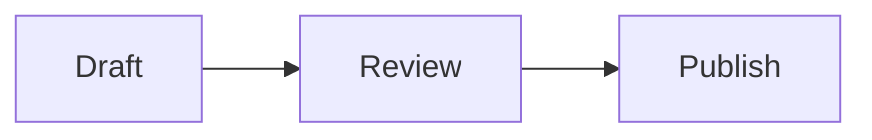
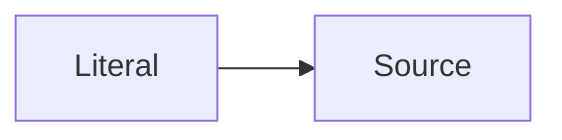

# Complete document block reference

Use SKILL.md for the .orbie header, package manifest, version, references, and limits. All examples here are body source; standalone files need the header. Optional metadata is strict JSON with no duplicate/unknown keys or nulls.

## Text and inline formatting

Paragraphs use blank-line separation. A source newline is a soft break; two trailing spaces or backslash makes a hard break. Headings use `#` through `######`; H1–H3 are the standard authoring/style controls, while H4–H6 source is retained. Title is separately stored in the header, so adding H1 is optional.

```markdown
# Heading

A **bold**, _italic_, ~~struck~~ sentence with `literal code`.
Visit [Example](https://example.com) or [email](mailto:hello@example.com).
:orbium[Colored and underlined]{"color":"preset:blue","underline":true}
```

Use normal safe links; HTML/script source stays literal rather than executing. Escape Markdown punctuation with backslash when it should be prose. For literal Orbium syntax use inline/fenced code or escaped opening punctuation. Reference-looking text in code and math has no relationship semantics.

## Direction, alignment, and empty blocks

```markdown
:::orbium {"kind":"block","dir":"rtl","align":"right"}
فقرة عربية.
:::

:::orbium {"kind":"block","dir":"ltr","align":"center"}

## Centered heading

:::

:::orbium {"kind":"empty","dir":"auto","align":"left"}
:::
```

`kind:block` wraps exactly one Markdown block. Alignment is valid only for paragraphs/headings; direction may apply to supported block contents. `kind:empty` is an atom with no body; use it for an authored empty visual block rather than assuming repeated blank lines will create visible height.

## Lists and checklists

```markdown
- First bullet
    - Nested bullet

3. Third item
4. Fourth item

- [ ] Pending
- [x] Done

:::orbium {"kind":"block","listType":"i"}

1. First Roman item
2. Second Roman item
   :::
```

`listType` accepts `1`, `a`, `A`, `i`, `I` and must wrap an ordered list. Keep ordinary Markdown list indentation/continuation correct. Check state lives in source, not account CSS.

## Quote and callout

```markdown
> A quotation.

> [!NOTE] Read first
> A note with **formatting**.

> [!TIP]+ Expanded tip
> This starts expanded and can fold.

> [!WARNING]- Collapsed warning
> Expand to read the details.
```

Callout marker is at the start of the first quoted paragraph. `+` starts a collapsible callout open, `-` starts it closed, no suffix is nonfolding. NOTE, TIP, IMPORTANT, WARNING, and CAUTION are conventional labels; other alphabetic custom labels are parsed, with letters/digits/underscore/hyphen after the initial letter. Their appearance follows the current renderer/theme; do not assume every label provides a distinct color. Quote every body line, including nested content. Do not place folding fields in Orbium JSON; folding lives in the marker.

## Divider

Plain `---`, `***`, or `___` creates a thematic break. Separate it from preceding text with a blank line to avoid a setext heading. Native styling:

```markdown
:::orbium {"kind":"block","dividerColor":"#75a1ff","dividerThickness":3,"dividerStyle":"double"}
---

:::
```

Color is lowercase six-digit hex; thickness integer 1–12; style solid/dashed/dotted/double. Only thematic breaks accept these fields. Double needs at least 3 px to visibly separate its lines. In the editor, double-click or Alt+Enter opens divider controls; Reset removes local overrides, and changes use autosave/undo.

## Code and Mermaid

Use language-tagged backtick fences such as python, php, typescript, bash, json, or sql. Choose a fence longer than any backtick run inside the code. Syntax colors/language labels/copy and code controls are renderer behavior, not serialized HTML. Unknown languages remain plain.

````markdown
```python
print("Orbium")
```



:::orbium {"kind":"code"}



:::
````

Bare mermaid fences create diagram previews. `kind:code` wrapping exactly one fenced code block preserves it as literal code even when tagged mermaid. Diagrams use the existing strict/sanitized renderer; invalid source remains editable with an error. Avoid executable HTML/scripts, click callbacks, and external resource assumptions. Do not assume Mermaid styling becomes account CSS or native document metadata.

## Math

```markdown
Inline $E = mc^2$.

$$
\int_0^1 x^2\,dx = \frac{1}{3}
$$

:orbium-math{"latex":"a + b"}

:::orbium {"kind":"math","latex":"a\n$$\nb"}
:::
```

Use dollar forms normally. JSON forms retain literal LaTeX when dollar delimiters would collide. `kind:math` requires latex and has no body. JSON-escape LaTeX backslashes/newlines correctly using an encoder. Math renders with the app's bounded, untrusted KaTeX behavior; unsupported math shows an editable error rather than granting script execution.

## Standard and rich tables

```markdown
| Item | Quantity |  Status   |
| :--- | -------: | :-------: |
| Book |        2 | **Ready** |
| Pen  |        3 |  Pending  |
```

Pipe tables are preferred for simple data. Use native table/row/cell directives for rich multi-block content, spans, or widths. Outer fences must exceed inner fence lengths. This complete 2-column example has a merged heading followed by two separate cells:

```markdown
:::::orbium {"kind":"table"}
::::orbium {"kind":"row"}
:::orbium {"kind":"cell","header":true,"colspan":2,"colwidth":[220,180]}
**Project summary**
:::
::::
::::orbium {"kind":"row"}
:::orbium {"kind":"cell","colwidth":[220]}
First paragraph.

- Rich item
- Another item
  :::
  :::orbium {"kind":"cell","align":"center","colwidth":[180]}
  $42$
  :::
  ::::
  :::::
```

Table/row allow only kind. Cell fields: align left/center/right, boolean header, positive integer colspan/rowspan, colwidth nonnegative integer array length equal to colspan (default 1). Spans must produce one rectangular grid, with no overlap/out-of-bounds; all nonzero widths for the same column must agree. Maximum 1,000 rows/columns and 10,000 occupied positions. The editor supports cell editing, navigation, selected grid operations, and merge/split; operations on existing complex spans may be restricted. Standard Markdown export flattens spans into readable cells.

## Image and file attachment

For a package with asset 10 (supported PNG/JPEG/GIF/WebP) owned by this page:

```markdown
:::orbium {"kind":"image","caption":"Overview diagram","width":480,"alignment":"center"}

:::

[Report.pdf](orbium:attachment/11)
```

Image wrapper contains exactly one image. It permits caption string, positive integer width, alignment start/left/center/right. Asset 11 is also owned by this page. Asset files have extensionless ZIP paths; original names live in the manifest. Images expose preview/resize/alignment/caption/replace/download/remove; file widgets expose filename/type/size/download. Metadata endpoints and downloads remain authorized by the app.

Single files use `#orbium-missing-image-10` and `#orbium-missing-file-11` instead of live assets; missing image wrappers retain caption/width/alignment. A remote image URL does not upload a binary. If another page also needs the binary, include another asset key/copy owned by that page.

## Mentions and missing items

Package page link: `[@Details](orbium:node/2)` with document 2 declared. Standalone omitted page: `[@Details](#orbium-missing-page-2)`. Folder/database mentions can be created in the live app with the picker, but document packages contain only documents. Mentions do not change hierarchy.

On package import live keys remap to new owned IDs. Missing fragments remain missing, with an explanation dialog instead of a guessed destination. Missing/deleted media remains a labeled placeholder. Treat suffixes as opaque keys, never destination database identities. All package source live references must resolve to included rows with proper ownership.
